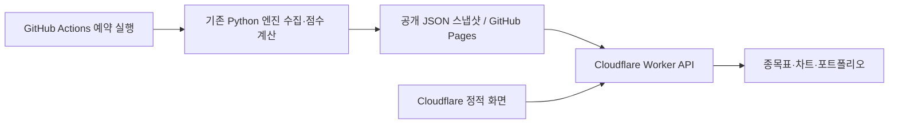

# Cloudflare 무료 운영

이 구성은 개인 PC가 꺼져 있어도 동작합니다. Cloudflare Workers가 화면·조회 API를 제공하고, 공개 GitHub 저장소의 Actions가 Python 수집·점수 계산을 실행합니다. 공개 시장 스냅샷만 GitHub Pages에 게시하며 실제 보유종목·수량·현금·토큰은 업로드하지 않습니다.

## 구성



Cloudflare 배포에는 `wrangler.jsonc`, `cloudflare/worker.mjs`와 `output/cloud-site`만 사용합니다. Python 서버를 Cloudflare Workers에서 실행하지 않습니다. 점수 규칙은 기존 Python 엔진에서 계산하므로 로컬과 동일합니다. 리스크 랩만 동일하게 문서화된 통계식을 JavaScript로 계산하며 Python gs-quant 실행 결과라고 표시하지 않습니다.

## 예약 갱신

`.github/workflows/cloud-data.yml`:

- UTC 월~금 15:23, 18:23: 가격·시장 지표 갱신
- UTC 월~금 22:23: 재무 포함 갱신
- 한국시간으로 다음 날 00:23, 03:23, 07:23
- 미국 서머타임과 휴장일에 따라 실제 장중/마감 후 간격이 달라짐
- 차트는 회당 최대 40개, 누락·오래된 캐시부터 순환 수집
- 데이터 공개본은 Cloudflare에서 최대 5분 캐시할 수 있음

GitHub 예약 실행은 지연·누락될 수 있고, 공개 저장소에 장기간 활동이 없으면 예약이 비활성화될 수 있습니다. 표시된 종목별 기준일을 확인하세요. 화면의 `최신 결과 보기`는 공개된 결과를 다시 읽으며 수집 작업을 시작하지 않습니다. 직접 수집은 GitHub Actions의 `Cloud market data → Run workflow`에서 실행합니다.

## 배포

```powershell
python scripts/build_cloud.py --refresh quick --history-limit 7 --portfolio-refresh
npx wrangler deploy
```

`build_cloud.py`는 기존 웹 화면과 정제된 시장 JSON만 복사합니다. `.cache/` 전체, SQLite 파일, Android APK, 토큰·접속 주소를 배포 대상으로 삼지 않습니다.

GitHub Pages는 저장소의 Settings → Pages → Source를 GitHub Actions로 설정합니다. Cloudflare의 `DATA_BASE_URL`은 해당 저장소의 고정된 공개 주소만 허용합니다. 예약 갱신을 위해 Cloudflare API 토큰을 GitHub에 저장할 필요가 없습니다.

## 기존 기능과 차이

- 종목 점수는 예약 수집된 스냅샷입니다. 실시간 체결 데이터가 아닙니다.
- 새로운 종목·이력은 예약 작업이 수집하기 전까지 비어 있을 수 있습니다.
- 포트폴리오 검색은 고정된 Yahoo 편의 endpoint와 저장된 목록을 사용합니다. 종목·환율·금의 기준일이 다를 수 있습니다.
- 스냅샷에 없는 보유종목의 시세 보완은 요청당 최대 16개입니다. 초과·실패 자산은 `unpriced`로 표시하며 합계에서 제외합니다.
- 포트 입력은 현재 브라우저의 localStorage에만 저장됩니다. 도메인이 달라지면 기존 localhost 저장값이 자동 이전되지 않습니다.
- 리스크 분석은 외부 조정 가격을 조회합니다. 공급자 제한이나 Workers 무료 실행 한도로 실패하면 오류를 표시합니다.
- 최신 공개 스냅샷이 불가하면 배포에 포함된 이전 자료를 사용하고 fallback 경고와 기존 기준일을 유지합니다.

## 검증

```powershell
python -m unittest discover -s tests -p "test_*.py" -v
node --test cloudflare/worker.test.mjs cloudflare/risk.test.mjs
node --check web/app.js
npx wrangler deploy --dry-run
```

Worker 테스트는 API 계약·정렬용 원천값·입력 제한·고정 공급자 주소·부분 실패·환율·현금·위험 통계의 결정적 예제를 검증합니다. 공급자 실제 가용성은 배포 URL에서 별도로 확인해야 합니다.
